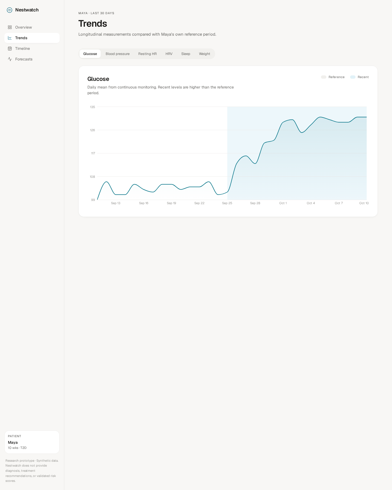
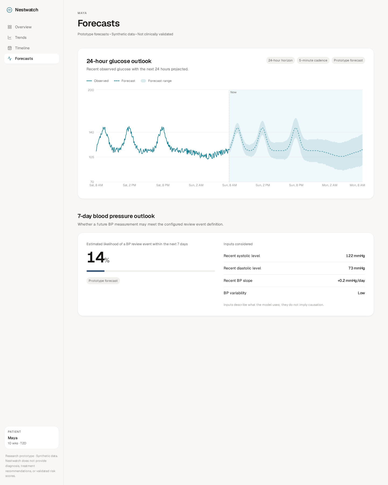

Built with two teammates at the Innovation Intelligence Hackathon at UC Berkeley during SF Tech Week 2026, where it won the Human Impact Track.

## The problem

Glucose, blood pressure, wearable and sleep data are usually reviewed separately from medication and pregnancy context. Looking at each number on its own can miss changes that only matter together.

Our first use case was patients with type 2 diabetes who stop GLP-1 medication when they become pregnant, a transition that carries higher risk and needs closer monitoring.

## What I built

I built the FastAPI backend. It combines wearable measurements with pregnancy and medication context and serves the patient dashboard through REST APIs.

- **Rule-based monitoring** that detects sustained changes across 5 groups of health signals, compared against each patient's own baseline
- **Forecasting APIs** for 24-hour glucose and 7-day blood pressure, using Ridge and logistic regression models
- **170+ automated tests** written with pytest

All patient data in the project is synthetic, including the demo patient.

## How it works

Health sources feed normalized device data into the backend, which adds patient context, runs the analysis, and returns everything a dashboard needs in one response.

Each status the system returns (`normal`, `watch`, or `change_to_review`) comes with the signals and reasons behind it. Missing or stale data is reported as such, instead of being treated as normal.

